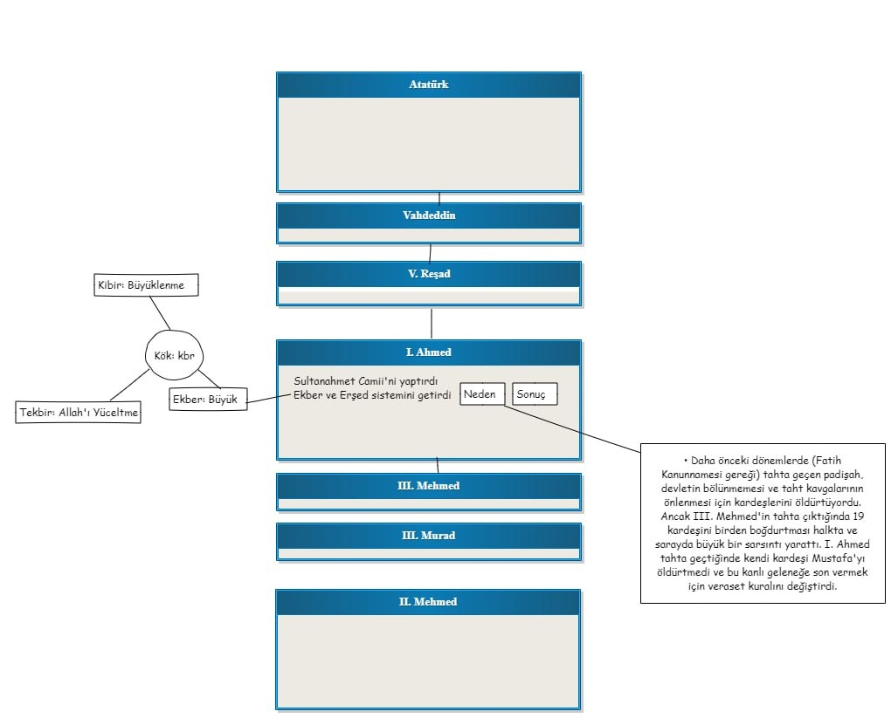

# History Journeys — Platform Requirements

## 1. Vision

History Journeys is a standalone website that shows the life journeys of
historical figures and lets the reader move between them. A reader picks two
figures, for example Fatih Sultan Mehmed (Mehmed II) and Mustafa Kemal Atatürk,
and the site offers routes from one to the other through related figures. Each
step of a route is a short card; anything on a card can be followed to further
knowledge.

The site is not meant to be an encyclopedia. Its purpose is to present concrete,
memorable facts and the cause-and-effect links between them, through a pleasant
interface, an interactive map, diagrams and learning games.

## 2. Goals and Non-Goals

### Goals

- G1. Show each figure's life journey in time and space (where they were, when, and what they did there).
- G2. Connect any two figures through one or more meaningful routes, and let the reader choose the route.
- G3. Keep every card short and concrete so that it can be remembered.
- G4. Explain actions through their causes and consequences.
- G5. Let the reader follow any person, place, event or concept to the next piece of knowledge.
- G6. Reinforce learning with games and spaced repetition.
- G7. Provide a shared engine (graph, cards, diagrams, review) that other content projects in this repository build on.

### Non-Goals

- NG1. Reproducing Wikipedia or hosting long-form articles.
- NG2. Covering every person who ever lived; coverage grows from a curated set of notable figures.
- NG3. Original historical research; content is derived from published sources.

## 3. Decisions

| # | Decision | Notes |
|---|----------|-------|
| D1 | The platform is a **standalone website**. | It is not a module of another application. |
| D2 | **All card content is generated by an LLM.** | The project owner intervenes while content is being generated; each intervention becomes a rule, and the LLM continues under the updated rules (§7). There is no separate approval step; one may be added later. |
| D3 | The first version covers **about 50 figures**. | An order of magnitude, not a fixed number: 40, 70 or 80 are all fine; 500 is not. Quality is improved iteratively through generation rules (§7). |
| D4 | The first version is built around **one primary line**, and also contains **additional lines**. | The primary line runs from Mehmed II to Atatürk through the Ottoman succession and related figures. |
| D5 | **Simple first, deeper on demand.** | A card states a fact in its simplest memorable form, the way schools first teach π as 3 or water boiling at 100 °C. The fuller account (a longer process, other actors, differing views) is one tap away (FR-27). The aim is curiosity: a reader who sees concrete links goes on to learn more. |
| D6 | **The first version stores no user data.** | No accounts, no learning progress, no analytics tied to a person. Features that need user data (FR-22, FR-23) come in later versions. |
| D7 | Spaced repetition, when added, uses **FSRS**. | The algorithm used by Anki; shared by every project in this repository. |
| D8 | Generated content is licensed **CC BY-SA 4.0**. | Compatible with Wikipedia (CC BY-SA 4.0), which is an input to generation (DR-3). Code stays MIT. |

## 4. Core Concepts

| Concept | Definition |
|---------|------------|
| **Figure** | A historical person. Has a name (per language), lifespan, places, roles and a portrait where an open-licensed one exists. |
| **Entity** | Anything a reader can navigate to: a figure, place, event, institution, concept or word. |
| **Relation** | A typed, directed link between two entities (for example *succeeded*, *child of*, *fought against*, *influenced*, *founded*). |
| **Card** | The unit of content for an entity: a title and a summary of **three sentences**, plus a list of the entity's notable actions. |
| **Action** | Something a figure did, shown on their card, with a **Cause** and a **Consequence**. |
| **Line** | A curated, ordered sequence of figures that forms a coherent story (for example the Ottoman succession). |
| **Route** | A path between two chosen figures through the relation graph. A pair of figures can have several routes. |
| **Journey** | A figure's life as a sequence of dated places, shown on the map. |

## 5. Functional Requirements

### 5.1 Figures and cards

- **FR-1** Each figure has a card with a three-sentence summary written for recall, not completeness.
- **FR-2** A card lists the figure's notable actions. Each action has two buttons, **Cause** and **Consequence**, that reveal a short explanation.
- **FR-3** A card can be expanded to show more detail (key dates, roles, places, relations, sources).
- **FR-4** Every person, place, event and concept mentioned on a card is a link to that entity's card.
- **FR-5** Words and terms can be explored as concepts. Example: on Ahmed I's card, the term *ekber* ("the eldest") opens its Arabic root *k-b-r* and related words such as *kibir* (arrogance) and *tekbir* (glorifying God).
- **FR-6** Every card shows the sources its facts were derived from.
- **FR-27** A statement that is simplified on the card carries a small depth marker. Opening it shows the fuller account: how the change came about over time, who else contributed, and differing views where historians disagree. The card itself stays short (D5).

### 5.2 Routes between two figures

- **FR-7** The reader selects any two figures; the site computes routes between them through related figures.
- **FR-8** When several routes exist, they are offered as alternatives (similar to choosing a route in a navigation app), each with a short description (for example "through the Ottoman succession", "through contemporaries").
- **FR-9** The chosen route is shown as a vertical chain of cards, ordered from one figure to the other.
- **FR-10** While reading a route the reader always sees the previous and the next cards around the current one.
- **FR-11** From any card on a route the reader can branch out (FR-4) and return to the route at the same position.
- **FR-12** Routes use only meaningful relation types and respect chronology; a route made of incidental links (two people who merely visited the same city) is not offered.
- **FR-28** Relation types and the weights used to compute routes are defined as versioned data in this repository. Every link between two consecutive cards on a route names its relation (for example Atatürk *served under* Mehmed VI, Ahmed I *succeeded* Mehmed III), so that no step is an unexplained jump.

#### Example: route card chain

The wireframe is a rough sketch of part of a route from Atatürk to Mehmed II along
the Ottoman succession, condensed to a few cards for readability; in the product
each link between cards names its relation (FR-28). The card for **Ahmed I** is
expanded and lists two actions:

- *Had the Sultan Ahmed Mosque built.*
- *Spared his brother Mustafa, ending the custom of royal fratricide; the throne
  began to pass to the eldest member of the dynasty (ekber ve erşed).*

Opening **Cause** on the second action explains it: under the earlier practice,
justified by the law code of Mehmed II, a new sultan had his brothers executed to
prevent wars of succession. When Mehmed III had nineteen of his brothers executed
on his accession in 1595, it shook the palace and the public. Ahmed I, who came
to the throne in 1603, did not execute his brother Mustafa.

The second action carries a depth marker (FR-27). Opening it adds what the
simple version leaves out: seniority was not decreed by Ahmed I in a single act
but settled into practice over the following decades, beginning when Mustafa I
succeeded him in 1617.

To the left, the term *ekber* is followed to its root *k-b-r* and related words
(FR-5).

### 5.3 Map

- **FR-13** Each figure's journey is shown on an interactive map as dated places, in order.
- **FR-14** The map has a timeline; moving it shows where figures were at that time.
- **FR-15** Historical borders for the selected period are shown where data exists.
- **FR-16** A route between two figures can also be viewed on the map.
- **FR-17** The precision of each location is recorded and shown (exact building, city, or approximate region).

### 5.4 Diagrams

- **FR-18** Lines, routes and related entities can be viewed as a diagram (nodes and edges) as well as a card chain.
- **FR-19** Nodes show their summary on hover or tap and open their card on click.
- **FR-20** Diagram branches can be collapsed and expanded.

### 5.5 Learning games and review

- **FR-21** Games built from the same data help retention. Initial candidates:
  - put figures or events in chronological order;
  - match an action to its cause or consequence;
  - find the missing figure in a route;
  - place an event on the map.
- **FR-22** *(Later version, D6.)* Cards the reader has seen can be reviewed with spaced repetition, scheduled by FSRS (D7).
- **FR-23** *(Later version, D6.)* Progress is visible on diagrams and maps: learned entities are marked, entities not reviewed for a long time are highlighted.

### 5.6 Look and feel

- **FR-29** The interface feels like a strategy game, not a website: a single persistent game screen whose stage is the map, with cards and panels opening over it instead of navigating to new pages.
- **FR-30** The map is a stylized, painted map in the spirit of the campaign map of the first *Medieval: Total War* (2002): terrain with relief and color, sea, rivers, readable place names and a few landmark markers for cities and figures. It is neither a flat web map nor photo-realistic.
- **FR-31** Cards look like illustrated parchment pages, in the spirit of the event cards of the same game: a framed illustration, a title, a short text and a seal. Card text is real text, so it stays sharp, translatable and accessible (NFR-4).
- **FR-32** Game-style interface elements frame the map: a minimap, a command bar with framed buttons, and the current date of the timeline.
- **FR-33** The game is a reference for mood only. No art, names, layouts or other assets are copied from it; all visual assets are original or open-licensed, and their licenses are recorded like data sources (DR-2).

### 5.7 Languages

- **FR-24** The first version is in Turkish. The interface and the data model support further languages from the start, so that content can be generated in other languages later.
- **FR-25** Names use the established form in each language (for example *Fatih Sultan Mehmed* in Turkish, *Mehmed II* in English).
- **FR-26** Dates can be shown in the Gregorian calendar and, where relevant, in the Hijri and Rumi calendars.

## 6. Data Requirements

### 6.1 Raw facts from open sources

Raw facts are imported, not written by hand. Facts about people, places and dates
are widely available as open data, in the same way that film data is available
from sources such as TMDB.

| Source | Use | License |
|--------|-----|---------|
| [Wikidata](https://www.wikidata.org) | Figures, lifespans, places of birth and death with coordinates, positions held, predecessors and successors, family, participation in events, names in many languages. Queried via SPARQL or the dumps. | CC0 |
| [Pantheon 1.0](https://pantheon.world) ([dataset](https://doi.org/10.7910/DVN/28201)) | Selecting notable figures: about 11,000 people with Wikipedia biographies in more than 25 languages, manually verified. | CC0 (the Dataverse dataset; verified 2026-11-24) |
| [OpenHistoricalMap](https://www.openhistoricalmap.org) | Historical borders and places by date. **Primary border source.** | CC0 by default ([license](https://wiki.openstreetmap.org/wiki/OpenHistoricalMap/License)); individual features may carry their own license tag, which the import keeps |
| [historical-basemaps](https://github.com/aourednik/historical-basemaps) | World borders as GeoJSON per year. **Not used in the first version.** | GPL-3.0 (verified 2026-11-24). If used later, its files are kept unmodified in a separate data directory with their GPL notice, never merged into our own data. |
| Wikipedia | Source material for generating cards. Text is not copied. | CC BY-SA 4.0 |
| Published chronologies and works (for example the ATAM and Ministry of National Education chronologies) | Sources for facts and dates. Facts are taken, the text is not reproduced; each is cited. | Copyrighted; used as cited sources only |

- **DR-1** Imports are repeatable scripts; imported data records its source and retrieval date.
- **DR-2** The license of every source is verified before its data is used, and attribution is shown on the site where required.
- **DR-3** Wikipedia text is used only as input for generation, and cards are written in new words. Because a close paraphrase can still count as a derivative work, generated content is itself released under CC BY-SA 4.0 (D8) and the site credits Wikipedia as a source, which satisfies the license either way. Direct quotations, if any, are attributed.

### 6.2 Our own layer

- **DR-4** Cards, actions with causes and consequences, curated lines and relation types beyond those in Wikidata are produced by this project (§7) and stored in the project's own data store.
- **DR-5** Every generated statement keeps a reference to the source passage it was derived from. These references form the bibliography stored in the data store and shown on the card (FR-6).

## 7. Content Generation

- **CG-1** All cards, actions, causes and consequences are generated by an LLM from the sources in §6.
- **CG-2** Generation follows a written **rule set** (style, length, what counts as a notable action, how to phrase causes and consequences, which sources to prefer). The rule set is versioned in this repository.
- **CG-3** The project owner intervenes while content is being generated; each intervention is turned into a rule or an example in the rule set, affected cards are regenerated, and the LLM then continues on its own under the updated rules.
- **CG-4** Generated content records the model, the rule set version and the generation date, so that it can be regenerated when the rules change.
- **CG-5** The first version contains 50 figures. Coverage grows only once the rule set produces consistently good cards.
- **CG-6** A human approval workflow is out of scope for the first version, but the data model keeps a status per card so that one can be added later.
- **CG-7** Contested interpretations are presented as such, with the differing views attributed, rather than stated as fact. The card keeps the simple form; the differing views go behind the depth marker (FR-27).
- **CG-8** The LLM proves every statement it writes by compiling it from reliable sources, independent ones where available, and stores the citations (DR-5). A statement supported by only one source is marked as such in the data store.

## 8. Scope of the First Version

- One primary line: from Mehmed II to Atatürk through the Ottoman succession and the figures connected to it.
- Additional lines that intersect the primary line, so that the reader can choose between several routes.
- About 50 figures in total (D3), with cards, actions, causes and consequences.
- Route chain view, card detail, map with journeys and timeline, at least one learning game.
- Turkish interface and content.
- No accounts and no stored user data (D6).

### 8.1 First milestone: prototype

Before the full first version, a working prototype establishes the foundation:
the application skeleton, data model and route engine, written cleanly, with a
user interface and experience that already look like the finished product, over
a small slice of the content. Religion History Diagrams is not started in this
milestone.

## 9. Non-Functional Requirements

- **NFR-1** Mobile-first: the route chain and cards are designed for a phone screen first.
- **NFR-2** Fast: a card or route opens without a visible delay on a typical mobile connection.
- **NFR-3** Shareable: every figure, route, card and map state has a stable URL.
- **NFR-4** Accessible: keyboard navigation, sufficient contrast, text alternatives for images and map content.
- **NFR-5** Open: the code, the generation rule set and the import scripts are public in this repository.
- **NFR-6** Private by design: the first version collects no personal data (D6), so it needs no accounts, consent flows or user database.

## 10. Constraints and Risks

| # | Constraint or risk | Mitigation |
|---|--------------------|------------|
| C1 | Producing memorable content is the largest effort: three-sentence summaries with causes and consequences do not exist in any open dataset. | LLM generation driven by a rule set (§7); small first scope. |
| C2 | Without a separate approval step, generated content can contain errors or invented facts. | Every statement is compiled from sources and keeps its citations (CG-8, DR-5); interventions become rules (CG-3); content can be regenerated (CG-4). |
| C3 | In a general knowledge graph almost any two people are connected within a few steps, so the shortest path is often meaningless. | Restrict routes to selected relation types, weight them, require chronological continuity, and offer several routes (FR-8, FR-12). |
| C4 | Historical borders and place names change over time; old locations are often imprecise. | Use dated border data (§6.1) and record location precision (FR-17). |
| C5 | Coverage of Turkish names and labels in open data is incomplete. | Fill gaps during generation and store them in our own layer. |
| C6 | Generation cost grows with the number of figures and every regeneration. | Measure cost per card in the first version before expanding coverage. |
| C7 | Source licenses differ (CC0, CC BY-SA, GPL, copyrighted chronologies). | Verify each license before use and show attribution (DR-2); release generated content under CC BY-SA 4.0 (D8, DR-3); keep GPL data out of the first version; take only facts from copyrighted works. |

## 11. Relation to Other Projects in This Repository

- [Atatürk's Life Journey](ataturk-life-journey.md) is the first content package and supplies the detailed journey of the figure at one end of the primary line.
- [Religion History Diagrams](religion-history-diagrams.md) uses the same engine (entity graph, cards, diagrams, spaced repetition) for the history of religions.

## 12. Open Questions

- Which additional lines are included in the first version, besides the primary line.
- Technology choices for the site, data store, graph queries and map rendering.
- Which language follows Turkish.
